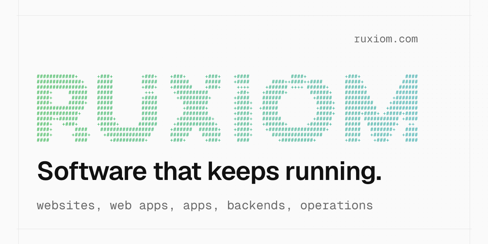

<p align="center"><picture><source media="(prefers-color-scheme: dark)" srcset="./banner-dark.png"></picture></p>

<p align="center">Ruxiom builds websites, web apps and apps for businesses, and keeps them running after launch.</p>

## What we build

| Service | What it covers |
| --- | --- |
| [Websites](https://ruxiom.de/en/services/websites) | Business and club websites with Astro and Storyblok |
| [Web apps & backends](https://ruxiom.de/en/services/web-apps) | Dashboards and tools with Hono APIs on Cloudflare |
| [Hosting & operations](https://ruxiom.de/en/services/hosting-operations) | Websites and applications running on Cloudflare Workers |
| [Migration to Cloudflare](https://ruxiom.de/en/services/cloudflare-migration) | Review of your setup, then a clear migration plan |
| [Automation & integrations](https://ruxiom.de/en/services/automation) | Connecting Linear, Stripe and Shopware 6 via APIs |
| [Apps for iOS and Android](https://ruxiom.de/en/services/apps) | Native Apple apps with SwiftUI; Android in Kotlin |
| [Security & incident response](https://ruxiom.de/en/services/security) | Regaining control after an incident, securing access and applications before one |
| [CTO as a Service](https://ruxiom.de/en/services/cto-as-a-service) | Technical leadership for architecture, stack and vendor decisions |
| [AI adoption for your business](https://ruxiom.de/en/services/ai-adoption) | AI tools for your team, with providers, contracts and data protection sorted out first |
| [Cloudflare](https://ruxiom.de/en/cloudflare) | Everything we build with and set up on Cloudflare |
| [iubenda partner](https://ruxiom.de/en/iubenda-partner) | Privacy policy, cookie banner and terms set up for you |
| [Website hacked](https://ruxiom.de/en/services/website-hacked) | 24-hour checklist and emergency help |

**Stack**

```text
Web       Astro, Storyblok, React, Next.js, TypeScript
Apps      SwiftUI, Swift, iOS 17+
APIs      Hono, Cloudflare Workers
Data      D1, Drizzle, R2, Workers KV, Durable Objects
Workflows Linear, Stripe, GitHub Actions, Fastlane
Tests     Vitest, Playwright, TestFlight
```

**On GitHub**

Client and product work lives in private repositories. Anything we open-source will appear here.

---

**[Discuss your project](https://ruxiom.de/en/contact)**

<sub>Auf Deutsch: [ruxiom.de](https://ruxiom.de)</sub>

<sub>Cloudflare, Cloudflare Workers, Durable Objects, Cloudflare Access, Cloudflare Tunnel, Cloudflare Registrar and other product names mentioned are trademarks and/or registered trademarks of Cloudflare, Inc. in the United States and other jurisdictions. iubenda is a trademark of iubenda S.r.l.</sub>
